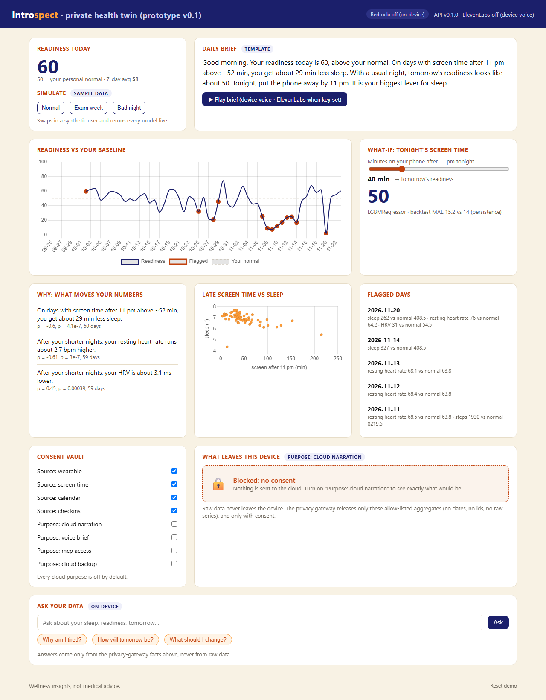
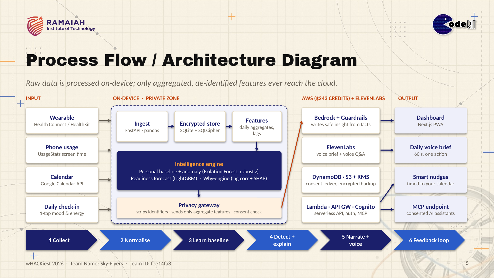
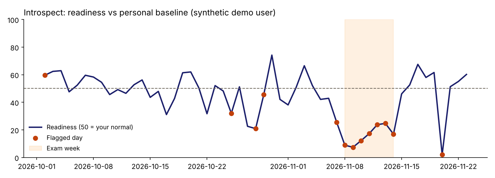

# Introspect: your data, your device, your insights

> A private AI "twin" that learns **your** normal from wearable, phone and calendar data,
> and tells you **what changed, why, and one thing to do about it**, without raw data ever leaving your phone.

**Team Sky-Flyers** · CMR Institute of Technology, Bengaluru · **wHACKiest 2026, Track 3: Know Thyself**
Balaji Keerthi (lead) · Deepesh Kumar Kotta · Aravindh Balaji · Abdul Hakeem K

**Status: Round 1 prototype (v0.1) + live-demo build.** The core ML pipeline, API, dashboard and privacy layer run
end to end, fully offline, on sample data today. The demo adds one-command start, a live scenario simulator, a visible
privacy gateway, an always-working voice brief and "Ask your data". The cloud side (Amazon Bedrock, ElevenLabs, AWS
deployment) is coded and tested with stubs, but has **not** yet been run against real AWS or ElevenLabs.



---

## The problem

Wearables record everything, but the data sits in separate apps, is compared with population averages
instead of *your* normal, and is processed in vendor clouds. About 1 in 3 owners stop using their tracker
within six months. Introspect is the insight layer on top of the devices people already own.

## What works today

| Component | File | Status |
|---|---|---|
| Ingest: Fitbit / Google export (public Kaggle schema), screen time, calendar, check-ins into one daily timeline | `introspect/ingest.py` | ✅ working |
| Synthetic demo user (60 days, Fitbit schema, with planted patterns we can check) | `introspect/synthetic.py` | ✅ working |
| **Personal baseline:** robust z-score vs *your* previous 28 days (median + IQR), cold start after 7 days | `introspect/baseline.py` | ✅ working |
| **Anomaly detection:** per-metric drift + multivariate Isolation Forest | `introspect/baseline.py` | ✅ working |
| **Why-engine:** lagged Spearman correlation + effect size, reports only if \|ρ\| ≥ 0.3 and p < 0.05 | `introspect/why.py` | ✅ working |
| **Readiness forecast + what-if** (LightGBM with monotonic constraints, backtested) | `introspect/forecast.py` | ✅ working (early, see results) |
| **Privacy gateway:** allow-listed aggregate facts only, consent checked per purpose | `introspect/privacy.py` | ✅ working |
| **Consent vault** (local JSON now, DynamoDB ledger in the cloud) | `introspect/consent.py` | ✅ working |
| Daily brief: offline template, or **Amazon Bedrock (Claude Haiku) + Bedrock Guardrails**, with an anti-hallucination number check; re-narrated when cloud consent changes | `introspect/narrate.py` | ✅ template live · Bedrock path tested with a stub |
| Voice brief: **ElevenLabs** (multilingual TTS) when a key + consent are set, otherwise the browser's offline device voice | `introspect/voice.py`, dashboard | ✅ device voice works offline · ElevenLabs coded, needs API key |
| **Ask your data:** answers questions only from privacy-gateway facts (on-device intent matcher; Bedrock with consent, grounding-checked) | `introspect/ask.py` | ✅ on-device live · Bedrock path tested with a stub |
| **Scenario simulator:** normal / exam week / bad night synthetic users, every model reruns live | `introspect/synthetic.py`, `POST /api/demo/scenario` | ✅ working |
| FastAPI backend (Lambda-ready via Mangum); the what-if model is trained once per dataset, so the slider is instant | `api/main.py` | ✅ working |
| Dashboard: readiness, flagged days, insights, what-if slider, simulator, consent vault, "What leaves this device" card, Ask, demo reset | `dashboard/index.html` | ✅ working |
| One-command start (`demo.bat` / `demo.sh`) | `scripts/start_demo.py` | ✅ working |
| **MCP server** so any AI assistant can read your insights, only with consent | `mcp_server/server.py` | ✅ working |
| **AWS SAM template:** Lambda, API Gateway, Cognito, DynamoDB, EventBridge Scheduler, S3 + KMS, Bedrock IAM | `infra/template.yaml` | ✅ passes `cfn-lint` · deploy on hack day |
| Tests (33) | `tests/` | ✅ passing |

## Architecture



1. **Collect:** wearable (Health Connect / HealthKit / Fitbit export), phone usage, calendar, 1-tap check-in
2. **Normalise:** one encrypted, local daily timeline
3. **Learn baseline:** your rolling normal for sleep, resting HR, HRV and steps
4. **Detect + explain:** drift and anomalies, plus the likely cause (why-engine)
5. **Narrate + voice:** the privacy gateway releases only aggregate facts; Bedrock writes the brief, ElevenLabs speaks it
6. **Feedback loop:** thumbs up/down on insights refines what you are shown (hack-day)

## Quick start

```bash
git clone <this repo> && cd introspect
python -m venv .venv && source .venv/bin/activate      # Windows: .venv\Scripts\activate
pip install -r requirements.txt

demo.bat                                                # Windows: starts the API + opens the dashboard
./demo.sh                                               # macOS/Linux (same thing: python scripts/start_demo.py)

python scripts/run_demo.py --plot                       # full pipeline in the terminal
uvicorn api.main:app --reload                           # dashboard at http://127.0.0.1:8000 (manual start)
pytest -q                                               # 33 tests
```

`demo.bat` checks dependencies, reuses a running server (or picks a free port), waits for `/api/health`, warms the
caches and opens the browser, usually in under 10 seconds. The **Reset demo** link in the dashboard footer
(or `POST /api/demo/reset`) restores default consent and the sample data.

> Windows with Smart App Control: the first import of freshly installed packages can fail with
> "An Application Control policy has blocked this file". Running the import again usually succeeds once Windows
> has checked the file; run `pytest -q` once after installing, before the demo.

### API

| Endpoint | What it does |
|---|---|
| `GET /api/health` | status, version, whether Bedrock / ElevenLabs are configured |
| `GET /api/timeline` · `/api/anomalies` · `/api/insights` | daily timeline, flagged days, why-engine insights |
| `GET /api/forecast?screen_min=&exam_tomorrow=` | tomorrow's readiness + what-if (prediction only; the model is cached) |
| `GET /api/brief` · `POST /api/brief/voice` | daily brief (template or Bedrock) · ElevenLabs MP3 (412 without key/consent, 502 if unreachable) |
| `GET /api/facts/{purpose}` | what would leave the device for a purpose (403 without consent) |
| `GET` · `POST /api/consent` | consent vault |
| `POST /api/ask` `{"question"}` | answer from gateway facts, with `source` = `on-device` or `bedrock` |
| `GET` · `POST /api/demo/scenario` `{"scenario"}` | `default`, `normal`, `exam_week`, `bad_night` |
| `POST /api/demo/reset` | default consent, default data, fresh caches |

Everything runs **offline** by default. Optional cloud features (copy `.env.example` to `.env`):

```bash
INTROSPECT_USE_BEDROCK=1     # uses your AWS credentials; needs Claude Haiku access in Bedrock
                             # .env is read automatically at startup (real environment variables win)
BEDROCK_GUARDRAIL_ID=...     # optional guardrail that blocks medical claims
ELEVENLABS_API_KEY=...       # voice brief
```

Cloud purposes also need the user's consent (toggle in the dashboard, or `POST /api/consent`). The header pill shows
"Bedrock: live" only when the brief actually came from Bedrock; otherwise everything stays on-device.

### Use the real public Fitbit dataset

Download the public Kaggle dataset *"FitBit Fitness Tracker Data"* (30 users, `Fitabase Data 4.12.16-5.12.16`) and run:

```bash
python scripts/run_demo.py --data "path/to/Fitabase Data 4.12.16-5.12.16" --user 1503960366
```

The loader picks one user, merges activity + sleep, and estimates resting HR from per-second heart rate.
That dataset has no HRV, screen-time or calendar data, so those insights only appear with the sample data or your own exports.

## Sample output (synthetic demo user)

```
Good morning. Your readiness today is 60, above your normal. On days with screen time after 11 pm
above ~52 min, you get about 29 min less sleep. With a usual night, tomorrow's readiness looks like
about 50. Tonight, put the phone away by 11 pm. It is your biggest lever for sleep.

Why-engine insights:
  - On days with screen time after 11 pm above ~52 min, you get about 29 min less sleep.  (rho=-0.6, p=4.1e-07, n=60 days)
  - After your shorter nights, your resting heart rate runs about 2.7 bpm higher.          (rho=-0.61, p=3e-07, n=59 days)
  - After your shorter nights, your HRV is about 3.1 ms lower.                             (rho=0.45, p=0.00039, n=59 days)

Tomorrow's readiness forecast (LGBMRegressor): 49.7
  what-if: screens off by 11 pm -> 56.0, usual night -> 49.7, 2 h late-night screen -> 45.3
  backtest MAE 15.2 vs persistence 14.0 / personal mean 21.4 (36 train / 16 test days)
```



## Early results (honest)

* **Why-engine** recovers the relationships we planted in the synthetic data (late screen time → less sleep →
  higher resting HR / lower HRV), with the strongest *actionable* driver ranked first.
* **Anomaly detection** flags the planted bad night (short sleep + high RHR + low HRV) and the exam week.
* **Forecast:** with only ~50 usable days, the LightGBM model beats the personal-mean baseline but is only
  on par with "tomorrow = today". Its value right now is the **monotonic what-if** (less late-night screen time
  never predicts a worse tomorrow). Hack-day goal: validate on the public Fitbit dataset and add sleep-timing features.
* Synthetic data proves the pipeline works; it does not prove real-world accuracy. We say this plainly.

## Privacy by design

* Raw data stays on the device. The **privacy gateway** (`introspect/privacy.py`) is the only path to the cloud:
  allow-listed, rounded aggregates; no ids, no raw time series, no exact dates.
* Every cloud purpose (narration, voice, MCP access, backup) is **off by default** and needs explicit consent,
  in line with India's DPDP Rules 2025.
* The LLM only rewords numbers our models computed. Any brief with a number not present in the facts is
  rejected and replaced with the template.
* **Wellness, not diagnosis:** no medical claims; Bedrock Guardrails filter them in the cloud path.

## AWS + ElevenLabs (sponsor tech)

| Service | Where |
|---|---|
| Amazon Bedrock (Claude Haiku) + Guardrails | `introspect/narrate.py`, IAM in `infra/template.yaml` |
| AWS Lambda + API Gateway + Mangum | `api/main.py` (`handler`), `infra/template.yaml` |
| Amazon Cognito | JWT authorizer in `infra/template.yaml` |
| Amazon DynamoDB | consent ledger table |
| Amazon EventBridge Scheduler | 07:00 IST daily brief job, `api/daily_brief_job.py` |
| Amazon S3 + KMS | opt-in encrypted backup |
| ElevenLabs multilingual TTS | `introspect/voice.py`, `POST /api/brief/voice` |

The build and our 4-week campus pilot are funded by the team's **US$243 AWS credits**.

## Hack-day plan (24 h)

- **H0–6:** Health Connect / HealthKit importers, validate on the public Fitbit dataset, upload-your-own-export in the dashboard
- **H6–12:** sleep-timing features, better readiness model, feedback loop on insights
- **H12–20:** deploy the SAM stack, Bedrock brief live, ElevenLabs voice in English and Hindi, Next.js PWA
- **H20–24:** MCP demo with an AI assistant, testing, pitch

## Repository layout

```
introspect/        core library (ingest, features, baseline, why, forecast, privacy, consent, narrate, ask, voice)
api/               FastAPI app (+ Lambda handler) and the scheduled daily-brief job
dashboard/         prototype web dashboard (Chart.js vendored, works offline)
mcp_server/        MCP server exposing consented insights to AI assistants
infra/             AWS SAM template (Bedrock, Lambda, API GW, Cognito, DynamoDB, EventBridge, S3+KMS)
scripts/           one-command demo start, CLI demo runner, sample-data generator
data/sample/       synthetic 60-day user in Fitbit export format
tests/             pytest suite
docs/              architecture diagram, screenshots
```

## Disclaimer

Introspect gives wellness insights, not medical advice. It does not diagnose, treat or prevent any condition.

## License

MIT, see [LICENSE](LICENSE). Chart.js is vendored under its MIT license (`dashboard/vendor/CHARTJS_LICENSE.md`).
